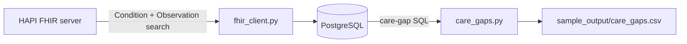

# FHIR Care Gap Finder
Finds diabetic patients who are overdue for an HbA1c test by pulling clinical data from a FHIR R4 server, storing it in PostgreSQL, and applying a care-gap rule in SQL.
## Why it matters
Regular A1c testing is a core diabetes quality measure. Care teams use gap lists like this one to find patients who need outreach before their condition goes unmonitored.
## Workflow

## How it works
1. **Extract** – `fhir_client.py` searches the FHIR server for diabetes Conditions (SNOMED `44054006`) and A1c Observations (LOINC `4548-4`), following `next` links to page through every result.
2. **Load** – `db.py` writes patients and A1c results to Postgres. Reruns replace the data, so they never duplicate rows.
3. **Analyze** – `care_gaps.py` flags diabetic patients whose most recent A1c is missing or more than 6 months older than the dataset's latest result.
4. **Export** – `export.py` writes the gap list to `sample_output/care_gaps.csv`.
## Tech stack
Python, `requests`, PostgreSQL, `psycopg`, Docker, HAPI FHIR, Synthea (synthetic patients), pytest
## Setup
1. Start HAPI FHIR and Postgres:
   ```
   docker run -d -p 8080:8080 hapiproject/hapi:latest
   docker compose up -d
   ```
2. Copy `.env.example` to `.env`.
3. Install dependencies:
   ```
   pip install -r requirements.txt
   ```
4. Download the [Synthea FHIR R4 sample data](https://synthea.mitre.org/downloads), unzip it into `data/synthea_sample_data_fhir_latest/`, then load it from `src/` (one time):
   ```
   cd src
   python -m care_gaps.load_data
   ```
5. Run the pipeline from `src/`:
   ```
   python -m care_gaps.main
   ```
## Tests
Unit tests use fake FHIR bundles, so no server is needed. Run them from the project root:
```
pytest -v
```
They cover paging through `next` links, parsing A1c Observations, and keeping results that have no recorded value.
## Sample output
```
4 of 13 diabetic patients have a care gap
Patient 42785: Last A1C: 2006-01-12
Patient 150108: Last A1C: 2020-11-09
Patient 142380: Last A1C: 2025-11-15
Patient 116775: Last A1C: 2026-03-18
```
## Design notes
- **One search, filter in SQL.** All A1c results are fetched in one paged search instead of one request per patient. At production scale, I'd chunk patient IDs into `subject=` searches to limit the data pulled.
- **Reference date.** Synthea histories can end before today, so the 6-month window is measured from the newest A1c in the dataset. `find_care_gaps` also accepts an explicit `as_of` date.